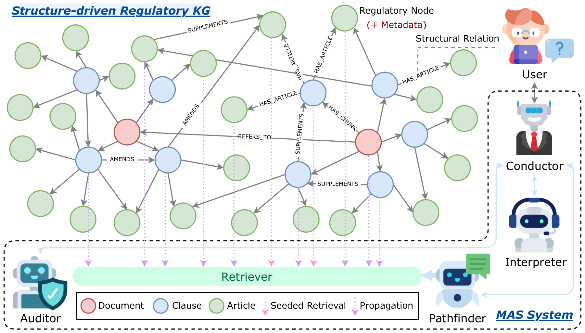
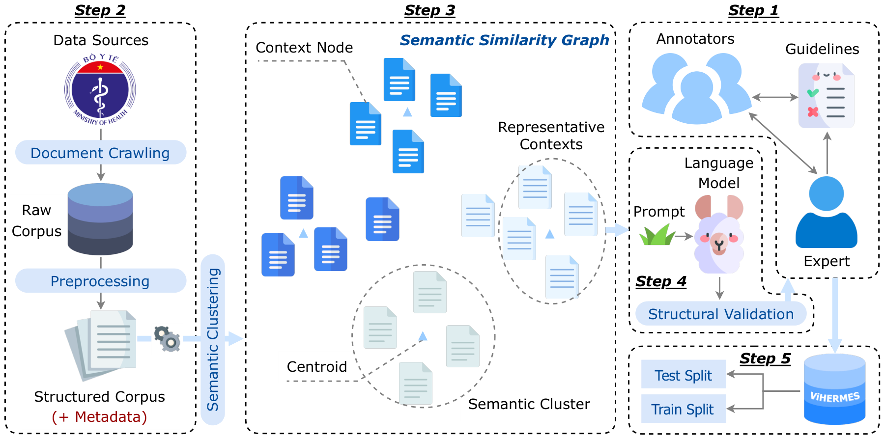
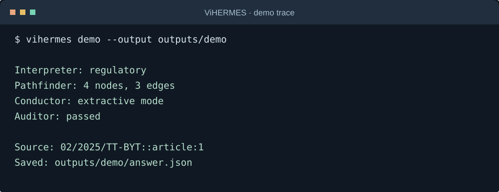

<p align="center">
  
</p>

<h2 align="center">Graph-Grounded Multihop Question Answering<br>for Vietnamese Healthcare Regulations</h2>

<p align="center">
  <a href="https://doi.org/10.1007/978-981-92-0071-9_22"></a>
  
  <a href="LICENSE"></a>
</p>

<p align="center">
  <a href="https://doi.org/10.1007/978-981-92-0071-9_22"><strong>Paper</strong></a> ·
  <a href="#method">Method</a> · <a href="#dataset">Dataset</a> ·
  <a href="#results">Results</a> · <a href="#run-the-code">Run the code</a> ·
  <a href="#evaluation">Evaluation</a> · <a href="#citation">Citation</a>
</p>

<p align="center">
  <strong>Long S. T. Nguyen*</strong> · <strong>Quan M. Bui*</strong> · Tin T. Ngo ·
  Quynh T. N. Vo · Dung N. H. Le · Tho T. Quan<br>
  <sub>URA Research Group · Ho Chi Minh City University of Technology (HCMUT) · Vietnam National University Ho Chi Minh City<br>* Equal contribution to the paper</sub>
</p>

## Overview

**ViHERMES** studies multihop question answering over **Vietnamese healthcare regulations**, where an answer may depend on several documents, their amendments, and cross-references. This repository accompanies the paper with its **dataset, graph-grounded QA implementation, and evaluation code**.

The research brings together three components:

- **A multihop benchmark** with questions spanning **1–5 hops**, annotated answers, reasoning, and supporting evidence.
- **A structure-driven regulatory graph** that connects documents, articles, and clauses through legal dependencies.
- **A graph-grounded QA method** that combines hybrid retrieval, relation-aware propagation, and answer verification.

## Method

ViHERMES represents regulatory documents as a **Structure-driven Regulatory Knowledge Graph (SRKG)**. Stable document, article, and clause IDs connect the text to its provenance and legal dependencies.

<p align="center">
  
  <br><sub>Legal structure connects retrieval, evidence propagation, and answer verification.</sub>
</p>

The pipeline combines four complementary roles:

| Role | Responsibility |
| :-- | :-- |
| **Interpreter** | Route the question and identify explicit document references |
| **Pathfinder** | Rank seed provisions with dense–sparse fusion and expand typed graph relations |
| **Auditor** | Validate citations, exact evidence spans, known dates/status, and semantic support |
| **Conductor** | Coordinate the workflow, synthesize supported claims, and request clarification or abstain when needed |

**Seeded retrieval** combines calibrated dense similarity and BM25 scores with a configurable weight. **Propagation** recursively follows `AMENDS`, `REPLACES`, and `SUPPLEMENTS`, expands `REFERS_TO` by one hop, and retrieves upstream provenance. Node, depth, and text budgets keep the context bounded.

The [architecture guide](docs/architecture.md) documents relation direction, placeholder resolution, agent contracts, and extension points.

## Dataset

The bundled release contains **1,561 question–answer records**, covering **one to five reasoning hops**, with evidence spans, supporting context IDs, and reasoning annotations. The accompanying [dataset guide](dataset/README.md) describes both source formats and their fields.

| Reasoning hops | 1 | 2 | 3 | 4 | 5 | Total |
| :-- | --: | --: | --: | --: | --: | --: |
| Released QA records | 312 | 312 | 312 | 312 | 313 | **1,561** |

The release includes **998 unique supporting passages**. Both [JSONL](dataset/dataset.jsonl) and [CSV](dataset/dataset.csv) preserve the source context IDs, questions, answers, evidence, and reasoning annotations.

The dataset construction workflow uses normalized embeddings, clustering, representative-context selection, cross-document tuple sampling, structured QA generation, and evidence validation.

<p align="center">
  
  <br><sub>From regulatory passages to evidence-grounded multihop questions.</sub>
</p>

The [construction instructions](docs/usage.md#construct-a-dataset) cover context selection, controlled hop counts, structured generation, and annotator review.

## Results

The [paper](https://doi.org/10.1007/978-981-92-0071-9_22) evaluates answer quality (**F1**), reasoning reliability (**LLM Judge**), and evidence retrieval (**Recall@5**). Scores below are the reported study results on a 0–1 scale; **bold** marks the best result in each column.

| Method | F1 ↑ | LLM Judge ↑ | Recall@5 ↑ |
| :-- | --: | --: | --: |
| Naive RAG (BM25) | 0.3076 | 0.2027 | 0.2617 |
| Naive RAG (Dense) | 0.3289 | 0.2433 | 0.3241 |
| Naive RAG (Hybrid) | 0.4127 | 0.3324 | 0.3989 |
| IRCoT | 0.4835 | 0.3751 | 0.4254 |
| MiniRAG | 0.5429 | 0.4856 | 0.5083 |
| RAPTOR | 0.5941 | 0.5783 | 0.5563 |
| LightRAG | 0.7855 | 0.6756 | 0.7256 |
| HippoRAG 2 | 0.8023 | 0.7332 | 0.8032 |
| **ViHERMES** | **0.8334** | **0.7554** | **0.8461** |

### Component ablations

The ablations isolate the contribution of intent interpretation, graph-based retrieval, and verification. The full method leads all three metrics.

| Configuration | F1 ↑ | LLM Judge ↑ | Recall@5 ↑ |
| :-- | --: | --: | --: |
| **Full method** | **0.8334** | **0.7554** | **0.8461** |
| Without Auditor | 0.8150 | 0.6823 | 0.8267 |
| Without Interpreter | 0.6540 | 0.5434 | 0.6134 |
| Flat hybrid retrieval in place of Pathfinder | 0.7734 | 0.6927 | 0.7955 |

### Key findings

The results point to three complementary sources of improvement:

- **Interpret the question before retrieval.** Removing the Interpreter lowers F1 from **0.8334 to 0.6540**, the largest drop among the tested ablations.
- **Follow legal dependencies.** Replacing Pathfinder with flat hybrid retrieval lowers Recall@5 from **0.8461 to 0.7955**.
- **Verify the generated claims.** Removing the Auditor lowers the LLM Judge score from **0.7554 to 0.6823**.

## Run the code

Use **Python 3.10 or newer**. Clone the repository, install the code, and run the self-contained example:

```bash
git clone https://github.com/longstnguyen/ViHERMES.git
cd ViHERMES
python -m venv .venv
source .venv/bin/activate
pip install -e .
vihermes demo --output outputs/demo
```

The demo uses **synthetic regulations**, a deterministic test encoder, and extractive answering. It follows a provision to its amendment and writes `outputs/demo/answer.json`; no API key, GPU, or database server is required.

<p align="center">
  
  <br><sub>Execution summary of the local demo; the full trace is saved as JSON.</sub>
</p>

For neural retrieval and generative QA, install `pip install -e '.[openai]'`, export `OPENAI_API_KEY`, and follow the [model setup](docs/usage.md#models-and-retrieval).

### Prepare the released corpus

Extract the source passages and build the local regulatory graph:

```bash
vihermes extract-contexts --qa dataset/dataset.jsonl \
  --output outputs/contexts.csv
vihermes ingest --input outputs/contexts.csv --db outputs/vihermes.db
```

Query the graph with BM25 retrieval:

```bash
vihermes retrieve --db outputs/vihermes.db --dense-weight 0 \
  'Hồ sơ đăng ký khám chữa bệnh gồm những gì?'
```

The [running instructions](docs/usage.md) cover neural retrieval, generative answers, raw-document ingestion, and optional Neo4j/Milvus storage.

## Evaluation

Run retrieval evaluation on every bundled record:

```bash
vihermes evaluate --qa dataset/dataset.jsonl \
  --db outputs/vihermes.db --dense-weight 0 \
  --output outputs/bm25 --ks 1,5,10
```

Each run writes:

| File | Contents |
| :-- | :-- |
| `predictions.jsonl` | Retrieved IDs, gold IDs, timing, and per-example metrics; answers when requested |
| `metrics.json` | Aggregate and per-hop scores with explicit denominators |
| `config.json` | CLI settings used for the run |

Add `--answers` for token-level answer F1 and `--judge` for an external LLM assessment of correctness, completeness, and evidence consistency. The default generative configuration uses **GPT-4o-mini**, **text-embedding-3-small**, and **GPT-4o** as judge. See the [evaluation guide](docs/usage.md#evaluate-retrieval-and-answers) for complete commands and scoring conventions.

## Code organization

The method separates legal graph construction, retrieval, agent reasoning, and evaluation into focused modules. Model and storage adapters let experiments share the same core implementation.

| Research component | Code |
| :-- | :-- |
| Regulatory parsing and graph construction | [`ingestion.py`](src/vihermes/ingestion.py), [`graph.py`](src/vihermes/graph.py) |
| Hybrid retrieval and typed propagation | [`retrieval.py`](src/vihermes/retrieval.py) |
| Interpreter, Pathfinder, Auditor, and Conductor | [`agents.py`](src/vihermes/agents.py) |
| Dataset loading and question generation | [`data.py`](src/vihermes/data.py), [`construction.py`](src/vihermes/construction.py) |
| Answer and retrieval metrics | [`evaluation.py`](src/vihermes/evaluation.py) |
| Model and database connections | [`adapters/`](src/vihermes/adapters/) |

See the [implementation notes](docs/architecture.md) for graph identities, relation direction, context budgets, and component contracts.

<details>
<summary><strong>Run the code checks</strong></summary>

```bash
pip install -e '.[dev,dataset]'
pytest -q
ruff check src tests
ruff format --check src tests
```

</details>

## Citation

If you use the ViHERMES dataset or system, please cite:

Long S. T. Nguyen, Quan M. Bui, Tin T. Ngo, Quynh T. N. Vo, Dung N. H. Le, and Tho T. Quan, “[ViHERMES: A Graph-Grounded Multihop Question Answering Benchmark and System for Vietnamese Healthcare Regulations](https://doi.org/10.1007/978-981-92-0071-9_22)”, in _Intelligent Information and Database Systems_, Springer Nature Singapore, pages 321–336, 2026.

```bibtex
@inproceedings{nguyen2026-aciids-vihermes,
  title        = {{ViHERMES: A Graph-Grounded Multihop Question Answering Benchmark and System
                  for Vietnamese Healthcare Regulations}},
  author       = {Nguyen, Long S. T. and Bui, Quan M. and Ngo, Tin T. and Vo, Quynh T. N. and
                  Le, Dung N. H. and Quan, Tho T.},
  editor       = {Nguyen, Ngoc Thanh and Chen, Chun-Hao and Fujita, Hamido and Hong, Tzung-Pei
                  and Manolopoulos, Yannis and Wojtkiewicz, Krystian},
  year         = 2026,
  booktitle    = {Intelligent Information and Database Systems},
  publisher    = {Springer Nature Singapore},
  address      = {Singapore},
  pages        = {321--336},
  doi          = {10.1007/978-981-92-0071-9_22},
  isbn         = {978-981-92-0071-9},
  url          = {https://link.springer.com/chapter/10.1007/978-981-92-0071-9_22},
}
```

## License

Copyright © 2026 Long S. T. Nguyen. The source code is released under the [MIT License](LICENSE). If you use the dataset or method in your research, please cite the [ViHERMES paper](#citation). Source regulatory documents retain their original provenance and terms.
